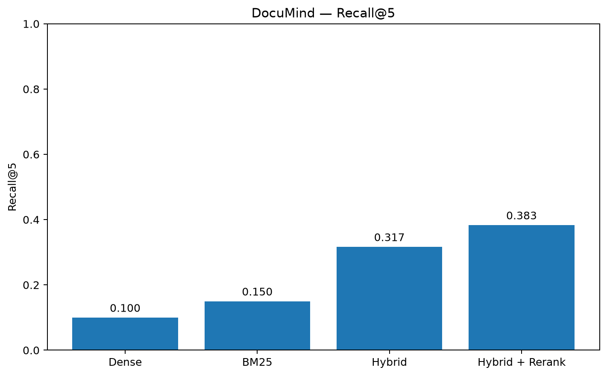
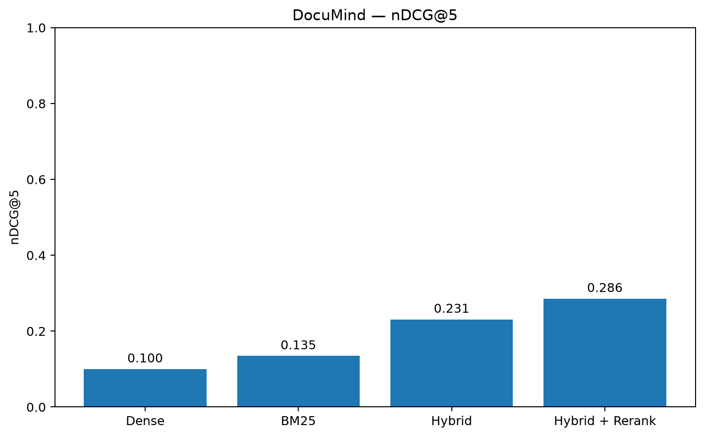
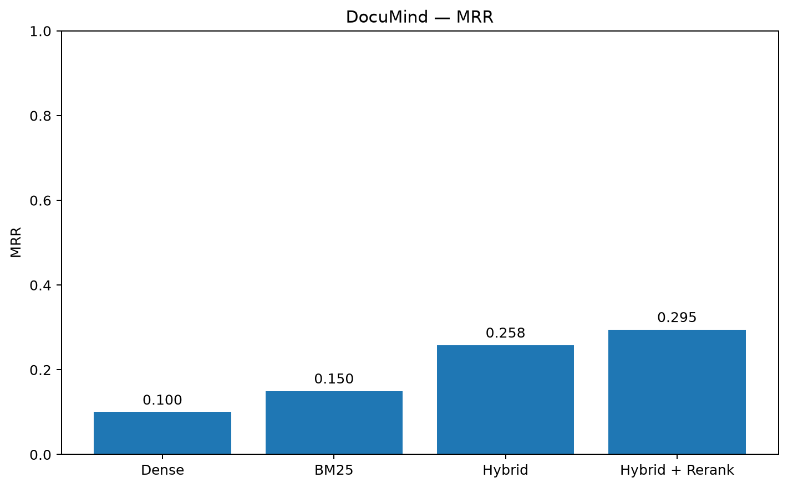
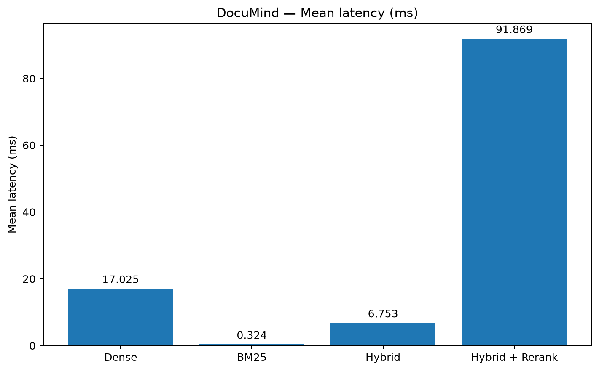

# DocuMind

### An Explainable, Self-Evaluating RAG Platform

DocuMind is an open-source document intelligence
platform focused on transparent retrieval,
evidence-grounded generation, and reproducible
evaluation.

## Planned Features

- [ ] Document ingestion and processing
- [ ] Dense and BM25 retrieval
- [ ] Hybrid search and reranking
- [ ] Retrieval X-Ray visualization
- [ ] Claim-level evidence verification
- [ ] RAG regression testing
- [ ] Interactive document chat
- [ ] Evaluation dashboard

## Tech Stack

Python · FastAPI · Qdrant · PostgreSQL
Next.js · Docker · Ragas · uv

## Quick Start

Install dependencies:

    uv sync

Start the backend:

    uv run uvicorn documind.api:app --reload

Run tests:

    uv run pytest


## Retrieval Benchmarking

DocuMind supports four retrieval strategies:

1. Dense semantic retrieval
2. BM25 keyword retrieval
3. Hybrid retrieval with Reciprocal Rank Fusion
4. Hybrid retrieval with cross-encoder reranking

### Evaluation

Dataset: The Common Pile v0.1 research paper

Metrics:
- Precision@5
- Recall@5
- MRR
- nDCG@5
- Retrieval latency

### Benchmark Results









### Reproduce

```bash
uv run python -m documind.evaluation.run \
  --dataset benchmarks/datasets/common_pile_questions.json \
  --output benchmarks/results/common_pile.json
```

Results are preliminary until relevance annotations
have been manually reviewed and finalized.


## License

MIT
